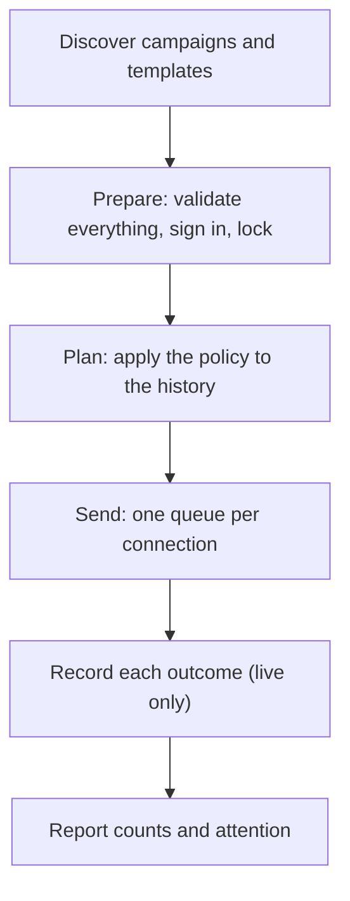

mailroll has a small vocabulary, and the CLI, the configuration files and the SDK all use the same words. This page defines each term once and shows how a run moves through them. The guides linked from each term go into detail.

## Building blocks

**Campaign.** A folder at `campaigns/<group>/<name>/` with a `campaign.config.json`. Its id is `<group>/<name>`, for example `acme/onboarding`. A campaign holds connections and templates. See [Campaigns](/guides/campaigns).

**Connection.** A Microsoft 365 mailbox the campaign can send from, declared in a JSON file under `connections/`. Each connection has its own environment variables for the Microsoft Entra tenant and client ID, and its own saved sign-in; several connections can point at the same app registration. A list sent through several connections is spread across them. See [Connect Outlook](/guides/outlook).

**Template.** A folder under `templates/` that defines one kind of message: its settings, its HTML body, its lists and its plugin. The folder name is the template id.

**Plugin.** The code file in a template's `code/` folder. It validates each CSV row, turning it into a recipient or rejecting it with reasons, and renders the message for one recipient. See [Templates](/guides/templates).

**List.** One CSV file in a template's `data/` folder. Each row is a potential recipient, identified by its `email` column. A template can have several lists, and each list has its own send history.

**Target.** One template paired with one of its lists. A run processes one or more targets, one after another. When you name several templates and several lists, every template is paired with every list.

## Choosing what happens

**Mode.** How far a run goes.

| Mode | Sends to | Records history |
| --- | --- | --- |
| `dry-run` | Nobody; renders only | No |
| `test` | One test inbox, for every message | No |
| `live` | The real recipients | Yes |

The [mode comparison](/guides/sending#compare-the-modes) covers sign-in, CC copies and other differences.

**Policy.** Which recipients a run sends to, given the history. The default, `pending`, sends to recipients with no recorded send and retries earlier failures. The others are `failed-only`, `force-all` and `subset`. See [Choose a policy](/guides/resending#choose-a-policy).

**CC policy.** A template setting, `ccPolicy`, that decides whether its messages must (`required`), may (`optional`) or must not (`forbidden`) carry a CC. `forbidden` protects messages that must not reach a third party.

## What mailroll remembers

**History.** The per-list record of live sends, kept in the template's `.state/` folder. Each recipient is `sent`, `failed` or `uncertain`; a recipient with no entry has never been sent to by a live run. Only live mode writes history. `sent` means the provider accepted the message, not that it was delivered. See [Send history](/guides/history).

**Uncertain.** The status of a send whose outcome mailroll cannot know, for example because Microsoft Graph did not answer in time or the process stopped in the middle of the send. The message may or may not have arrived. mailroll does not resend uncertain recipients unless you choose a policy that does. See [Uncertain sends](/guides/history#uncertain-sends).

**Needs attention.** A list needs attention when its run ends with any recipient failed, uncertain, not attempted, or still uncertain from an earlier run, or with a message whose required CC the provider rejected (`"ccPolicy": "required"`). A rejected optional CC does not count by itself, and neither do rows rejected by the validator. The CLI exits with code 1 when any list needs attention.

## How a run works

Every run, from the CLI menu, `mailroll send` or the SDK, goes through the same stages.

1. **Discover.** mailroll reads every campaign under the campaigns folder and checks its configuration files. An invalid file stops the run with an error that names it.
2. **Prepare.** For each target, mailroll loads the plugin, reads the CSV, runs the validator over every row, fingerprints the file and loads the history. Then it checks the secrets of every connection (test and live mode), resolves the CC addresses and asks you for one if needed (every mode), signs in to every connection (test and live mode) and locks every list (live mode). Nothing is sent until all of this succeeds.
3. **Plan.** For each list, the policy compares the valid recipients with the history and decides who is sent to and who is skipped, with a reason for each skip. The recipients to send are then dealt round-robin across the selected connections.
4. **Send.** Each connection works through its share in its own queue, and the queues run in parallel. Each message is rendered just before it is sent. Pacing, retries and throttling apply per message; see [Retries and throttling](/guides/sending#retries-and-throttling).
5. **Record.** In live mode, mailroll writes an entry to the list's history before each send and another with the outcome after it. A send that started but has no recorded outcome is treated as uncertain on the next run.
6. **Report.** Each list ends with counts of sent (or rendered), failed, uncertain, not attempted and skipped recipients, plus the addresses that need attention.

Targets run one after another. Before each one starts, mailroll checks that its CSV has not changed since preparation; if it has, the run stops and nothing more is sent.

## Next steps

- Build your own campaign: [Campaigns](/guides/campaigns).
- Write a plugin: [Templates](/guides/templates).
- Send safely through the three modes: [Sending](/guides/sending).
- Understand the history and uncertain sends: [Send history](/guides/history).
