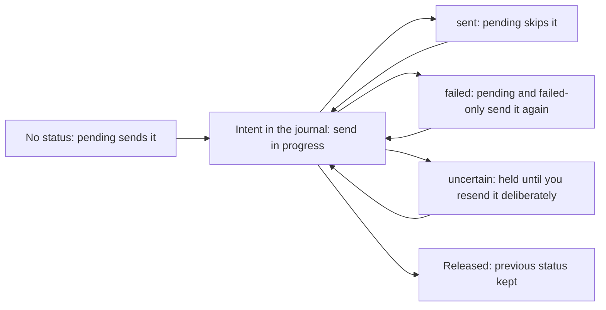

A live run records the outcome of every send in the list's history, and the next run reads it to decide who to send to. This page explains what is recorded and when, and what to do when a run is interrupted, a send is uncertain, or the history cannot be used.

Only live runs write history. Dry-runs and test runs read it to apply the policy but never change it.

A `sent` status means the provider **accepted** the message for the recipient. It never means the message was delivered, opened or read; mailroll cannot know that.

## What is recorded

Each CSV list of a template has its own history in the template's `.state/` folder, named after the CSV file. For `data/recipients.csv` that is:

- `.state/recipients.jsonl`, the **journal**: one line is appended for every step of every send while the list runs.
- `.state/recipients.json`, the **snapshot**: the status of every recipient, rewritten when a list finishes.
- `.state/recipients.json.lock`, the **lock**, present only while a live run uses the list. See [Locks](#locks).
- `.state/recipients.json.v1-backup` and `.state/recipients.jsonl.v1-backup`, only for a list that was upgraded from mailroll 0.1. See [Upgrading an older history](#upgrading-an-older-history).

mailroll creates these files readable only by your user. See [State files](/reference/files#state-files) for the full layout.

### The journal

The journal starts with a header line, `{"format":"mailroll-journal","version":2}`. For each recipient, a live run then writes up to two lines. Each line is flushed to disk before the run moves on:

1. An **intent**, just before the message goes to the provider.
2. Then exactly one of these:
   - an **outcome**: the recipient's new status (`sent`, `failed` or `uncertain`), written once the send finishes;
   - a **release**: written when the provider did not accept the message and mailroll stopped trying: the connection's sign-in failed, the provider refused the whole connection, the connection's retries ran out, or you stopped the run before the send or while it was waiting to retry. A release leaves the recipient's previous status unchanged.

```json .state/recipients.jsonl wrap
{"format":"mailroll-journal","version":2}
{"email":"ada@example.com","intent":{"at":"2026-01-15T09:30:00.000Z","connectionId":"outlook-1","attemptId":"3f2b8c1e-6d4a-4f9b-8e2c-5a7d9b1c0e4f"}}
{"email":"ada@example.com","status":{"status":"sent","at":"2026-01-15T09:30:01.000Z","connectionId":"outlook-1","attemptId":"3f2b8c1e-6d4a-4f9b-8e2c-5a7d9b1c0e4f"}}
```

Addresses are stored in lowercase.

### The snapshot

When a list finishes and every intent has an outcome or a release, mailroll writes the snapshot to a temporary file, renames it into place, and deletes the journal:

```json .state/recipients.json wrap
{
  "version": 2,
  "templateId": "welcome",
  "recipients": {
    "ada@example.com": {
      "status": "sent",
      "at": "2026-01-15T09:30:01.000Z",
      "connectionId": "outlook-1",
      "attemptId": "3f2b8c1e-6d4a-4f9b-8e2c-5a7d9b1c0e4f"
    },
    "grace@example.com": {
      "status": "failed",
      "at": "2026-01-15T09:30:02.000Z",
      "connectionId": "outlook-1",
      "category": "permanent",
      "message": "Microsoft Graph sendMail failed (HTTP 400): ...",
      "attemptId": "8c4e2a1f-0b9d-4e7c-a6f5-3d2b1c0e9f8a"
    }
  },
  "updatedAt": "2026-01-15T09:30:02.000Z"
}
```

- `status`: `sent`, `failed` or `uncertain`.
- `at` and `connectionId`: when, and from which connection, the recorded outcome happened.
- `category` and `message` (failed only): why the send failed.
- `message` (uncertain only): why the outcome is unknown.
- `resendFailure` (on `sent` or `uncertain` only): a later resend that failed or was uncertain without replacing the status. See [What a resend records](/guides/resending).
- `updatedAt`: the `at` of the last recipient entry a live run recorded. An entry that kept an earlier status and only added a `resendFailure` keeps that earlier `at`, so `updatedAt` can be older than the run. A live run that records nothing keeps the previous value (`1970-01-01T00:00:00.000Z` for a new list).
- The evidence fields `attemptId`, `providerMessageId`, `cc` and `uncertainAttemptIds`, described in [Evidence for tracing](#evidence-for-tracing).

If an intent is still open when the list finishes, which happens when an outcome could not be written, mailroll keeps the journal instead and logs `state.journal_kept`. Nothing is lost: every run reads the snapshot first and then replays the journal on top of it.

### A recipient's lifecycle



A send always starts with an intent and ends with an outcome or a release. A failed recipient goes back through the cycle on the next `pending` or `failed-only` run. Sent and uncertain recipients only go through it again when you choose `force-all` or `subset`. An intent that never gets an outcome, because the process died, is read as an uncertain send the next time the history is read: the recipient becomes `uncertain`, or, if it was already `sent`, stays `sent` with the uncertain attempt in `resendFailure`. See [Run again safely](/guides/resending) for how a resend's outcome combines with the previous status.

## Evidence for tracing

Some entries carry evidence that helps you find a message with your provider. Evidence is for tracing only: none of it proves that a message was delivered.

- **`attemptId`** identifies one send intent: the attempt to send one message to one recipient in one run. Retries of that intent, after a definite rejection such as throttling, keep the same `attemptId`; the integration receives it together with a call number. A deliberate resend in a later run gets a new one. The journal's intent line carries it, so even an interrupted send keeps it.
- **`providerMessageId`** is the identifier the integration returned for an accepted message, kept as it was received. The Outlook integration returns none.
- **`uncertainAttemptIds`** keeps the `attemptId` of every earlier intent for the recipient that ended uncertain and is no longer shown in the entry. For example, if a deliberate resend `B` of a sent message is uncertain and a later resend `C` is accepted, the entry is `sent` with `attemptId` `C` and `uncertainAttemptIds` `["B"]`: `B` may still have been delivered.
- **`cc`** records CC addresses the provider rejected; see [Rejected CC](#rejected-cc).

mailroll never invents evidence. Entries written by mailroll 0.1, and sends through providers that receive no attempt ids, have none.

`mailroll status --json` lists the entries that need tracing in `evidence`; see [status](/cli/status).

## Rejected CC

Integrations that report each recipient separately can tell mailroll that the provider accepted the message for the main recipient but rejected one or more CC addresses. The Outlook integration reports the message as a whole, so it never reports a rejected CC.

- The main recipient is `sent`. A rejected CC never puts the recipient back in the queue: `pending` and `failed-only` skip them like any other sent recipient.
- The entry's `cc` lists the rejected addresses and whether the CC was required, according to the template's `ccPolicy` when the message was sent.
- With `"ccPolicy": "required"`, the run **needs attention** (exit code `1`) and the summary lists the message as `CC REJECTED (required)`.
- With `"ccPolicy": "optional"`, the summary shows a note and the exit code stays `0`, unless something else in the run needs attention.

The summary counts messages with a rejected CC, not rejected addresses. See [Automation](/guides/automation) for the JSON fields.

## Live, test and dry runs

| | Live | Test | Dry run |
| --- | --- | --- | --- |
| Sends | To the list's recipients | Every message to the test address | Nothing |
| Writes history | Yes | No | No |
| Evidence in the summary | Yes, and recorded | Yes, but not recorded | No |
| Upgrades a v1 history | Yes, at its first write | No; warns that the next live run will | No; warns that the next live run will |

In a test send, a rejected CC is reported for the send to the test address and the summary says that nothing was recorded. The next live run still sends to every list recipient.

## Uncertain sends

A send is **uncertain** when mailroll cannot know whether Microsoft accepted the message. That happens when:

- Microsoft Graph does not answer within 120 seconds: `no answer from Microsoft Graph within 120 s; the message may or may not have been sent`.
- Graph answers HTTP 408 or a 5xx status. The exception is a 503 with a readable `Retry-After` header (a number of seconds or an HTTP date), which counts as throttling; a 503 whose `Retry-After` is missing or unreadable is uncertain.
- The connection fails in a way that does not prove the request never left your machine: `connection to Microsoft Graph failed (...); the message may or may not have been sent`. Failures that do prove it, such as a DNS error or a refused connection, are retried instead. See [Retries and throttling](/guides/sending#retries-and-throttling).
- The run ended between the intent and the outcome: `the run ended before the outcome of this send was recorded (crash, kill or power loss)`.
- With the SDK, a custom provider throws an error that is not a recognized `SendError`: `unexpected send failure: <error>; the message may or may not have been sent`. See [Errors](/sdk/errors).

mailroll never retries an uncertain send by itself, because the message may already be in the recipient's inbox. On later runs, `pending` and `failed-only` skip the recipient and report them as `still UNCERTAIN`, and the run needs attention (exit code `1`) until you resolve it.

### Resolve an uncertain send

<Steps>
  <Step title="Find the uncertain recipients">
    The run summary lists them as `UNCERTAIN` (this run) or `still UNCERTAIN` (an earlier run), and `--json` lists them in `attention` with status `uncertain` or `held-uncertain`. `mailroll status` shows the count per list.
  </Step>
  <Step title="Check whether the message went out">
    Look in the sending mailbox's Sent Items, or export them with `mailroll-outlook export-sent`; see [Verify sends with export-sent](/guides/export-sent). Sent Items only has a copy when the template sets `"saveToSentItems": true`; with the default, `false`, Microsoft does not keep one.
  </Step>
  <Step title="Resend only the ones that did not arrive">
    Send to those addresses deliberately. `--cc ""` sends without CC instead of asking; pass the addresses the original send used if it had a CC:

    ```bash Terminal
    npx mailroll send -c acme/onboarding -t welcome \
      --connection outlook-1 -m live --confirm --cc "" \
      --policy subset --recipients ada@example.com
    ```

    Use `--policy force-all` only if everyone in the list should receive the email again.
  </Step>
</Steps>

mailroll has no command to mark an uncertain recipient as sent. If you confirm that the message was delivered and do not want to resend it, the recipient stays uncertain and keeps the run in "needs attention". Removing the row from the CSV stops that, because only rows in the list are planned.

## Interruptions and Ctrl-C

How a run ends decides what the history holds afterwards:

- **First Ctrl-C.** mailroll prints `stopping: sends in flight will finish, nothing else is sent (press Ctrl-C again to quit now)`. Sends already talking to Microsoft Graph finish and their outcomes are recorded. A send waiting to retry or waiting out throttling is released. Every other recipient is reported as not attempted and keeps its previous status, so the next `pending` run picks them up. Lists that had not started are reported as not run. The summary is printed, and the exit code is `130`.
- **Second Ctrl-C.** mailroll exits immediately with `130`. A send that was in progress has an intent without an outcome, so that send is read as uncertain on the next run.
- **Ctrl-C at a prompt or during sign-in.** The run is canceled before anything is sent, and the exit code is `130`.
- **Crash, kill or power loss.** Any other way the process ends, including `SIGTERM` from a scheduler, leaves open intents behind. Those sends are read as uncertain on the next run. The lock file stays behind too; see [Locks](#locks).

## Automatic stops

mailroll stops sending on its own in these cases:

- **Three uncertain sends in a row on one connection.** That connection stops for the rest of the list, because a run of uncertain answers suggests a Microsoft outage. Its remaining recipients are reported as `connection "<id>" stopped after 3 uncertain sends in a row (provider outage?); not attempted`. Other connections continue.
- **Authentication failure.** If a connection's token cannot be obtained during the run, or Graph answers 401 or 403, the current send is released and the connection is quarantined for the rest of the list. Its remaining recipients are reported as `connection "<id>" quarantined (authentication failed); not attempted`. Other connections continue. Fix the sign-in or the app permissions before the next run; see [Connect Outlook](/guides/outlook).
- **An error that affects the whole list.** If a message cannot be rendered, or a history line cannot be written, the list stops: every connection finishes its current send and starts no new one. Unsent recipients are reported as not attempted (on the connection where the error happened: `run stopped by an error before this send; not attempted`), the remaining lists are not run, and the command exits with `1`.

In all three cases, recipients that were not attempted keep their previous status and are picked up by the next `pending` run.

### When the history cannot be written

If a history line cannot be written, for example because the disk is full, the folder is not writable, or the run lost the list's lock, the list stops. The message says which write failed and what it means for the recipient:

```text Output wrap
could not record send state after sending to ada@example.com; the history will read this attempt as uncertain, so check whether it was delivered before resending: ...
```

| Failed write | Message starts with | What it means |
| --- | --- | --- |
| Intent, before the send | `could not record send state before sending to <address>; this run did not call the provider for it, though the history may read this attempt as uncertain` | This run did not send the message |
| Outcome, after the send | `could not record send state after sending to <address>; the history will read this attempt as uncertain, so check whether it was delivered before resending` | The provider was called; check before resending |
| Release, after a stopped send | `could not record send state after the send to <address> stopped without the provider accepting it (it may not have been called); the history will read this attempt as uncertain` | The provider did not accept it |
| Snapshot, when the list ends | `could not record send state snapshot; no recorded outcome is lost, and the next live run replays the journal` | The journal still holds every outcome |

Each message ends with the cause: an error from the file system; if the run no longer holds the list's lock, `ConfigError: the send state of … can only be written by the store that holds its lock …`, or, when the lock was lost just after an intent was written, `ConfigError: the intent to send to <address> was written to the send state of …, but right after it this run could no longer confirm that it holds its lock (…); nothing was sent to <address>, and the history now reads it as uncertain`, or, when it was lost while the history files were being prepared or compacted, `ConfigError: … while preparing the history files this run could no longer confirm that it holds it (…); it stopped before changing them further` or `ConfigError: the snapshot of the send state of … was written, but right after it this run could no longer confirm that it holds its lock (…); the journal was kept, so no record written by another run was removed`; or another refusal of the history files, such as `ConfigError: cannot upgrade …` or `ConfigError: the state journal at <path> disappeared during the run; …`. A lost lock is not a disk problem: something deleted or replaced the lock file during the run, and another run may have started on the same list; see the warning under [Locks](#locks). For every failed intent, outcome or release, the log also has a `recipient.unrecorded` error event with the recipient, the connection and the `stage` that failed. If an intent is still open when the list stops, mailroll keeps the journal and logs `state.journal_kept`, so the next run reads that send as uncertain.

Fix the cause, then check the named recipient before resending, unless the message says this run did not call the provider. With several connections, writes are shared: a recipient on another connection whose write was refused right after the failure gets a message with its own stage and address, but carries the cause of the write that failed first.

## Locks

Before a live run sends anything, it creates a lock file next to each list's history. The lock holds the process id, the host name, the start time and a random `token` that only this run knows. A second live run on the same list stops before sending anything:

```text Output wrap
the send state of "welcome" · recipients.csv is in use by another run (process 4242 on build-01, since 2026-01-15T09:30:00.000Z). Wait for it to finish; if no run and no lock recovery is active on this list (campaigns/acme/onboarding/templates/welcome/.state/recipients.json.lock.recover does not exist), delete campaigns/acme/onboarding/templates/welcome/.state/recipients.json.lock
```

The locks of all lists are taken after sign-in and before the first send, and released when the run ends, also when it fails. Dry-runs and test runs do not take locks. Before every write to the history, the run checks that the lock file still holds its `token`; once a check fails, the run starts no other write and stops. A line the run was already appending when the lock was lost can still reach the journal; see the warning below for when that matters. Two more checks protect the other run:

- After writing an intent, and before calling the provider, the run checks again. If the lock was lost while the intent was being written, the run stops without sending that message. The history then reads that recipient as uncertain with the message `the run ended before the outcome of this send was recorded (crash, kill or power loss)`, although this run did not call the provider for it.
- Right before each step that replaces, shortens or deletes a history file (writing the snapshot, deleting the journal, cutting off a torn last line, and the steps of the v1 upgrade), the run checks again and stops without that step if the lock is no longer its own. So a run that lost its lock normally does not overwrite or delete what the run that took the list over has written; the warning below lists the exceptions.

### Stale locks

If a run died and left its lock behind, the next live run recovers it by itself, and logs `state.lock_recovered`, only when it can prove that run is gone: the lock has the same host name and the same process space (`pidSpace`; on Linux, the same boot and the same PID namespace, which in practice means the same container or the same host outside containers), and no process with its id exists. Otherwise it keeps the lock and stops with the message above, followed by `, and mailroll cannot tell whether that process is still running: <reason>`. This happens for a run on another machine, in another container with the same host name, or before a restart; for a container that has been restarted or removed since; for a lock written by mailroll 0.1, which records no process space; and on platforms other than Linux, macOS and Windows. In those cases, check every machine and container that shares the folder, and delete the lock yourself only once its run has ended. On macOS and Windows the process space is only the host name, so give each machine that shares a folder its own host name. See [Lock](/reference/files#lock).

Only one run recovers a lock at a time. It first creates `recipients.json.lock.recover`, and another run that finds that file stops:

```text Output wrap
the send state of "welcome" · recipients.csv is being recovered by another run (process 4310 on build-01, since 2026-01-15T09:31:02.000Z); try again when it finishes. If that process is not a mailroll run (its process id may have been reused), make sure that no mailroll run and no lock recovery is active on this list, then delete campaigns/acme/onboarding/templates/welcome/.state/recipients.json.lock.recover
```

A recovery normally takes a moment. If the process ends during it, `.recover` stays behind, and mailroll never removes it by itself, because it cannot tell an unfinished recovery from one still running on another machine. The next live run stops with `… cannot be recovered: an earlier recovery of <lock> did not finish and left <lock>.recover (…)`. Before you delete anything, make sure that no mailroll run and no lock recovery is active on this list, on every machine that shares the folder. Then delete the `.recover` file, and the lock too if the process that holds it is not running. A crash during recovery can also leave `recipients.json.lock.stale-<id>`, which is safe to delete when no recovery is active, and `.tmp` files, which are safe to delete when no run is active. See [What is safe to delete](/reference/files#what-is-safe-to-delete).

A recovery also stops, without deleting anything, if the lock keeps changing while mailroll tries to recover it, or if the lock is deleted or replaced by hand in the middle of it. See [Lock kept changing during recovery](/troubleshooting#lock-kept-changing-during-recovery) and [Lock replaced while it was being recovered](/troubleshooting#lock-replaced-while-it-was-being-recovered).

<Warning>
Delete a lock file only when you are sure no run is using that list on any machine. If you delete the lock of a run that is still sending and start another run, the first run stops at its next write, right after its next intent, or right before it would replace or delete a history file, and the second run reads any send the first one had started as uncertain instead of sending it again. Usually the cost is attention: the message the first run was about to send is not sent and stays uncertain until you resolve it, and a send already in flight ends uncertain because its outcome cannot be written.

This greatly reduces the risk of a duplicate, but does not rule it out:

- **A paused process.** Each check and the file step it protects are separate file-system calls. If the operating system suspends the first run between the two, for example on sleep, Ctrl-Z (SIGTSTP) or SIGSTOP, a debugger or a frozen virtual machine (a suspended job is still a running run), for as long as the second run needs to take the list, send and write its history, the first run can still overwrite that history, which erases every send the second run recorded, and a later `pending` run sends them all again. The same applies to a journal line the first run was already writing: the history keeps the last status written for each recipient, and a release line closes the recipient's open send. If the first run is suspended after its check and before it appends `failed` for a recipient, and meanwhile someone deliberately resends that recipient from the second run, with `subset` or `force-all`, and it records `sent`, the late `failed` line comes after the second run's line. A `failed-only` run then sends that recipient again, unless the second run wrote its snapshot after that line. Likewise, a late release line can close a send that the second run deliberately started and did not finish because it crashed, so a later `pending` run sends it again.
- **Reused file identity.** A run treats the lock as its own only when the lock file holds its `token` and is still the same file (same device and file number). After its lock file is deleted, a copy of it put back by hand or by a sync tool fails that check, unless the file system happens to give the copy the file number of the deleted file. File systems do reuse file numbers, so this cannot be ruled out, though it needs a copy of the lock to be restored at that moment.
- **File systems.** The checks rely on every run seeing, at once, the files another process has just written. That holds on a local disk, and is likely, but not verified, on NFS. It is not established on SMB shares, on Windows folders opened from WSL (`/mnt/c`), or in folders kept in sync by iCloud, OneDrive, Dropbox or Syncthing; do not share a campaigns folder that way between runs.
- **Older versions.** A run of an earlier mailroll sharing the folder does not make these checks.
- **Other state stores.** A program that runs `runTemplate` with its own state store, one that takes no lock, gets none of this protection.

A send that timed out at the provider stays uncertain whatever the lock does.

mailroll does not support these setups, and a duplicate there is not a bug it can prevent: resuming a suspended run after its lock was deleted; concurrent runs on one list from an SMB share, a Windows folder opened from WSL, or a synchronized folder; machines that share a folder under the same host name; a run of mailroll 0.1 on a list that mailroll 0.2 also uses, before or after the upgrade; a state store that takes no lock; and deliberately resending an uncertain recipient while another run on the list may still be alive.
</Warning>

## Changed CSV files

mailroll fingerprints each CSV (SHA-256) while preparing the run, and again just before the list starts sending. If the file changed in between, the run stops before that list sends anything:

```text Output wrap
recipients.csv of "welcome" changed after the run was prepared; nothing more was sent — run again
```

Lists that finished earlier keep their recorded history. The menu, and the SDK when you pass a reviewed fingerprint, also compare the file with the version you reviewed and stop with `changed after you reviewed it; nothing was sent — review it again`.

## Damaged history

- **An incomplete last journal line**, left by a write cut short, is ignored when the history is read, and the next live run removes it before appending. If that line was an outcome, the recipient's intent is still open, so that send is read as uncertain. A last line that is complete but lacks its final newline is read normally; the next live run keeps it and adds the newline before appending.
- **Any other unreadable journal line** stops every run on that list before it sends: `corrupt state journal at <path> (line N)`.
- **An unreadable snapshot** stops the run with `corrupt state file at <path>` (not valid JSON) or `invalid state file at <path>: ...` (unexpected content, including a field mailroll does not know).
- **A history from a newer mailroll**, or a v2 journal next to a v1 snapshot or no snapshot, stops every run on that list without changing anything.
- **A v1 history mailroll cannot keep in full** (a field mailroll 0.1 never wrote, or an unreadable complete last journal line) can still be read, but a live run refuses to upgrade it at its first write and stops before sending. The refusal arrives inside the history-write error, for example `could not record send state before sending to <address>; …: ConfigError: cannot upgrade the state file at <path>: …`.

See [Damaged or incompatible state](/reference/files#damaged-or-incompatible-state) for every message.

mailroll does not repair these files for you. Keep a copy, inspect the reported line or field, and fix or remove it by hand.

<Warning>
Do not delete a damaged history to get past the error. Without history, the `pending` policy sends to everyone in the list again.
</Warning>

## Upgrading an older history

mailroll 0.2 reads histories written by mailroll 0.1 and upgrades each list the first time a live run writes to it. The upgrade copies the old snapshot to `<stem>.json.v1-backup`, moves the old journal unchanged to `<stem>.jsonl.v1-backup`, and adds no evidence the old files did not have. After the upgrade, mailroll 0.1 refuses the list's history, so do not go back to 0.1 for that list unless you follow [Restoring the v1 files](/reference/files#restoring-the-v1-files), which is only safe while nothing has been sent with 0.2.

If the upgrade is interrupted, the next live run finishes it. See [Upgrade from the v1 format](/reference/files#upgrade-from-the-v1-format).

## Related

- [Run again safely](/guides/resending): policies and what a resend records.
- [Verify sends with export-sent](/guides/export-sent): check what a mailbox actually sent.
- [State files](/reference/files#state-files): every file mailroll writes.
- [Troubleshooting](/troubleshooting).
